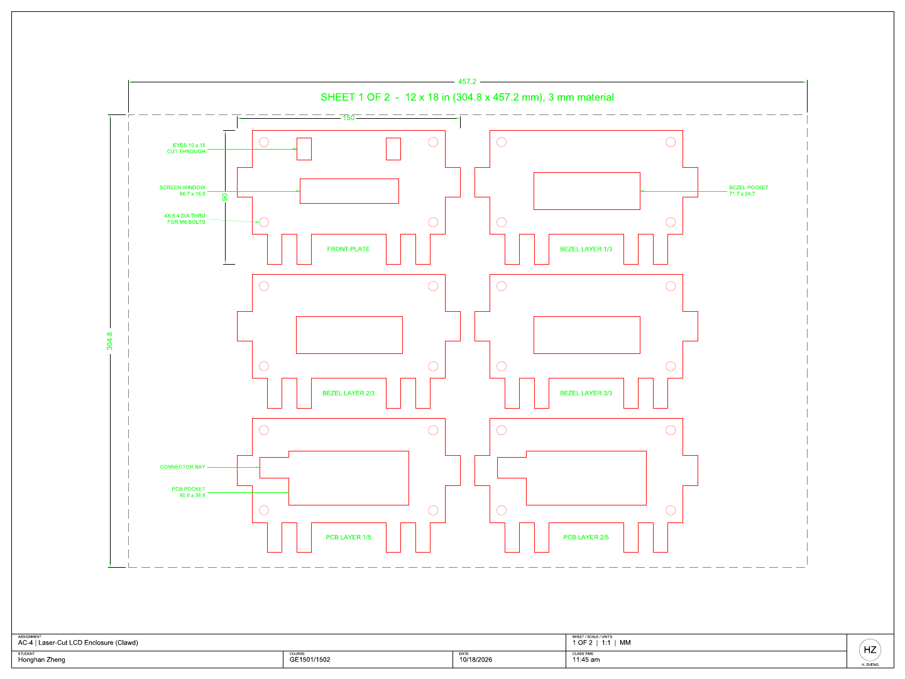
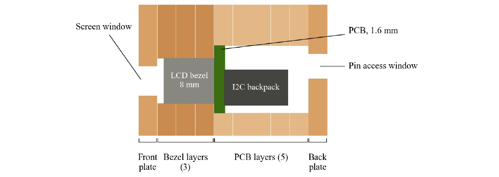

# 👾 Clawd Token Counter

**A laser-cut Clawd that lives on your desk and tells you how many Claude Code tokens you've burned today.**

<!-- TODO: swap this drawing for a photo or GIF of the finished build -->


Clawd cycles through four screens, 4 seconds each (example values):

| Screen | Top row | Bottom row |
|---|---|---|
| Tokens today | `TOKENS TODAY` | `94,160,868` |
| Output and replies | `OUTPUT 1,203,445` | `REPLIES 312` |
| Clock | `Tue, Oct 20 2026` | `03:41:07 PM` |
| Last reply | `LAST REPLY` | `02:58 PM 43m ago` |

- Reads your local Claude Code logs (`~/.claude/projects`). Nothing leaves your computer.
- A plain ESP32 + 16x2 I2C LCD, connected to your computer over USB.
- Laser-cut files are ready for a 12 x 12 in. bed, and the bolts are 3D-printable.

Started as AutoCAD Lab #4 for GE1501/1502 (Cornerstone of Engineering) at Northeastern University, Fall 2026.

> Unofficial fan project. Clawd and Claude Code belong to Anthropic. This project is not affiliated with or endorsed by Anthropic.

## How it works

The enclosure is ten 1/8 in. layers stacked together. Every layer uses the same 150 x 90 mm Clawd outline, drawn on a 10 mm grid so it only has straight lines. The four legs work as a stand. Only the opening in the middle changes from layer to layer, so the stack holds the LCD like slices around it and covers it on all six sides.



| Layer | Count | Opening | What it does |
|---|---|---|---|
| Front plate | 1 | 66.7 x 16.5 mm window, two 10 x 15 mm eyes | Shows the screen, keeps the module from falling out the front |
| Bezel layer | 3 | 71.7 x 24.7 mm pocket | Holds the metal bezel of the LCD |
| PCB layer | 5 | 80.6 x 36.6 mm pocket + connector bay | Holds the board and the I2C backpack, leaves room for the wire connectors |
| Back plate | 1 | 31 x 14 mm pin window, 4 mm LED hole, 5 mm contrast hole | Lets the four wires be connected with the screen inside |

Four 6.4 mm holes go through every layer for M6 bolts that clamp the stack together.

The drawing in `works/` has 3 bezel and 5 PCB layers. After measuring, my LCD is only 12 mm thick, so the files in `FYELIC/` cut 1 bezel and 4 PCB layers instead. That is 7 pieces and 15 mm of space for the LCD.

## Files

| Path | What it is |
|---|---|
| `works/Zheng_AC4.dwg` | AutoCAD drawing (all layers, dimensions, leaders, title block) |
| `works/Zheng_AC4.dxf` | Same drawing as DXF |
| `works/Zheng_AC4.pdf` | 2-page drawing at 1:1, one 12 x 18 in. sheet per page |
| `works/Zheng_AC4_Memo.pdf` | Design memo |
| `FYELIC/Zheng_AC4_CUT_12x12.pdf` | Cut lines only, one 12 x 12 in. page per sheet, for the laser cutter |
| `FYELIC/Zheng_AC4_CUT_12x12.dxf` | Cut lines only as one DXF, the three sheets side by side (sheet outlines on a non-printing `SHEET` layer) |
| `3D_print/M6x40_bolt.stl`, `M6_nut.stl` | Printable M6 bolt and nut |
| `3D_print/M6_bolts_and_nuts_x4.3mf` | 4 bolts + 4 nuts on one plate |
| `3D_print/*.bgcode` | Sliced file for the Prusa MK4 |
| `LCD.dwg` | LCD reference drawing provided by the course |
| `Display/Display.ino` | ESP32 sketch for the screen |
| `Display/claude_usage.py` | Script that totals today's Claude Code tokens and sends them to the ESP32 |

## Laser cutting

- Material: 1/8 in. (about 3 mm) or thinner. Two 12 x 12 in. sheets with 4 and 3 parts. One part on sheet 1 is turned 90° to fit, which doesn't change the part.
- Red lines are cuts. The files in `FYELIC/` only have the red cut lines, so they can go straight into the FYELIC template.
- Measure the real sheet thickness first. If it is thinner than 2.5 mm, add a fifth PCB layer.
- Cut the front plate and one bezel layer first and test them with the LCD. If the pocket is too tight, open the clearance from 0.3 mm to 0.4 mm before cutting the rest.

## 3D printed bolts

M3 threads are too small to print well on an FDM printer, so the holes are sized for M6 instead.

- Printer: Prusa MK4, 0.4 mm nozzle, PLA
- Nozzle 205 °C, bed 70 °C, 15% infill, everything else default
- Print the bolts standing up with the head on the bed
- If the bolt is too tight in the nut, scale the bolt to 98% and print it again

Store-bought M6 x 40 mm bolts and nuts work too.

## Assembly

1. Lightly sand the burnt edges.
2. Stack the layers in order (front, 1 bezel, 4 PCB), using the bolts to line them up.
3. Glue the front plate and bezel layers with wood glue.
4. Put the LCD in from the back. There is about 3 mm of extra depth, so add a piece of foam tape behind the backpack to keep it from moving.
5. Add the back plate and tighten the four bolts. Don't overtighten printed threads.

## Display

`Display/Display.ino` runs on an ESP32 and drives the LCD over I2C with the `hd44780` library. On your computer, `Display/claude_usage.py` adds up today's Claude Code usage from the local session logs and sends it to the ESP32 over USB serial (115200 baud) each time it refreshes. The screen rotates through the four pages shown at the top. If no data arrives for a minute, the token pages show `NO DATA`. The counts start over at local midnight.

To run it:

```bash
pip install pyserial
python3 Display/claude_usage.py --watch 10 --port auto
```

`--watch 10` refreshes every 10 seconds. `--port auto` looks for `/dev/cu.usbserial-*` or `/dev/cu.usbmodem*` (macOS). Leave out `--port` to only print today's totals in the terminal.

The startup screen says `HELLO, Honghan!`. Change it in `setup()` in `Display.ino` before you flash your own.

## Key LCD dimensions

From `LCD.dwg`, checked against a 1602 datasheet.

| Part | Size (mm) |
|---|---|
| PCB | 80 x 36 |
| Metal bezel | 71.1 x 24.1 |
| Viewing area | 64.7 x 14.5 |
| I2C backpack | 41.9 x 19 |
| Pin header | 4 pins, 2.5 mm pitch |

---

Honghan Zheng · Project made for GE1501/1502 · Fall 2026
